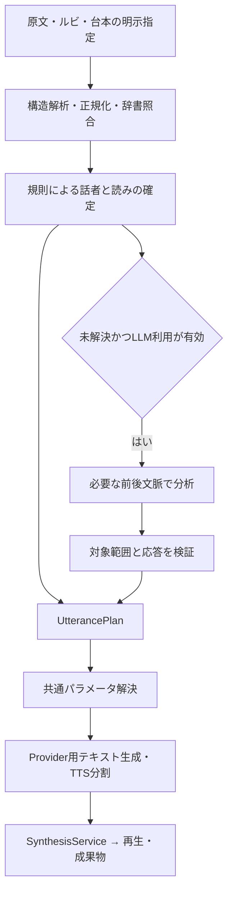

# 読みの補正・合成品質を中心とする設計レビューとリファクタリング計画

- レビュー日: 2026-09-14
- 対象: 未コミットの変更を含む、レビュー時点の作業ツリー
- 状態: SQ-001〜005の実装・自動検証済み。SQ-006〜007も実装・移行文書・実音声生成まで実施。
  聴感評価と実LLM測定は未完了（第9節）。
- 目的: 合成音声ソフトの辞書を補い、合成パラメータを適切に調整しながら計算コストを減らす

現状は、小説の話者・シーン・感情の分析に対し、読みの根拠を保持する仕組みと入口間の
処理の一貫性が弱い。改善の中心を、原文と読み指定の保持、発話境界の共通化、必要な箇所だけの
LLM利用に置く。削減率や聴感上の改善幅は未測定であり、本書の提案を実測済みの効果と扱わない。

## 1. 既存計画との関係

| 文書 | 担当する範囲 | 本計画との関係 |
|---|---|---|
| [アーキテクチャ](../architecture.md) | レイヤー、共通Plan、合成サービス | 既存の基盤と依存方向を利用する |
| Runtime finding / 修正進捗（git 履歴） | 合成、キャンセル、成果物、設定などの実行時契約 | 達成済みの契約を回帰させない |
| [LLM基盤移行計画](../llm-platform-migration-plan.md) | Provider、ルーティング、予算、キャッシュ | 実装済みの機構を使い、呼び出しの必要性を判断する処理を追加する |
| [ADR-0002](../adr/ADR-0002-utterance-plan-and-identities.md) | UtterancePlanとplan/runの分離 | 読み情報と原文位置の拡張時に移行契約を追加する |

過去のタスクの完了記録は書き換えない。本計画の所見は、2026-09-14の通常経路で確認した
意味の保持・品質・計算コストに関する追加の評価である。`SQ-*` の状態と受入条件は本書で管理する。

## 2. 所見

P1は読みの正確さ、通常経路の一貫性、無駄な推論を直接左右する項目、P2は継続利用や品質評価の
改善項目とする。「再現」は外部サービスを使わない確認、「実装確認」はソースを追跡した結果、
「評価課題」は実音声などによる追加測定が必要な判断を意味する。

| ID | 優先度 | 所見 | 根拠の種類 | 対応タスク |
|---|---|---|---|---|
| SQ-F01 | P1 | ルビの読みを捨て、原文と合成用テキストを十分に分離していない | 再現・実装確認 | SQ-002 |
| SQ-F02 | P1 | BatchとSDKで会話境界・話者の分析結果が失われる | 再現 | SQ-003 |
| SQ-F03 | P1 | 通常ReaderにLLMの必要性を判定する分岐がなく、既存ルールも無条件確定には弱い | 再現・実装確認 | SQ-003, SQ-005 |
| SQ-F04 | P1 | Readerの分析窓とBatchの出力予算が実際の要求制限に整合しない | 再現・実装確認 | SQ-004 |
| SQ-F05 | P2 | 読みの再利用が一時キャッシュに留まり、補正の適用も入口によって異なる | 実装確認 | SQ-002, SQ-003 |
| SQ-F06 | P2 | パラメータ変更の聴感上の効果を、計算コストと比較する基準が不足している | 実装確認・評価課題 | SQ-001, SQ-006 |

### SQ-F01: 確実な読み情報を失っている

[AozoraSource._parse](../../src/yomiage/sources/aozora.py) はrubyのrbを残してrtを捨てる。
[TextProcessor.process_html](../../src/yomiage/nlp/text_processor.py) でも、
`<ruby><rb>小鳥遊</rb><rt>たかなし</rt></ruby>さん`から得られた出力は`小鳥遊\nさん`だった。
なろう、カクヨム、汎用Webのソースにも同様のrb優先処理がある。

[Utterance](../../src/yomiage/core/models.py) の本文は基本的に単一の`text`であり、
[BatchEngine._romanize_entries](../../src/yomiage/batch/engine.py) は英字読みの変換結果で
`SentenceEntry.text`を上書きする。元の表記を字幕や修正画面へ戻すこと、どの辞書が効いたかを
説明すること、辞書変更後に必要な部分だけ再合成することが難しい。

読みの正解が入力にある場合は、それを位置付きの指定として保持する。原文を単純に仮名へ
置換するだけでは、表示用の表記と文脈解析用の情報を再び失うため、保存契約から修正する。

### SQ-F02: 発話境界を入口ごとに作り直している

[BatchAnalyzer](../../src/yomiage/batch/analyzer.py) は文分割と分類を独立に行い、
`_map_segments_to_sentences`で先頭20文字などの部分一致から対応を推定する。
[TextSplitter._split_sentences](../../src/yomiage/nlp/splitter.py) と組み合わせると、
次の入力の台詞後半が地の文に対応付いた。

```text
入力: 太郎は言った。「おはよう。今日は晴れだね。」花子はうなずいた。
出力の一部:
  「おはよう。       → dialogue / 太郎
  今日は晴れだね。   → narration / 話者なし
```

[SDK Pipeline.stream](../../src/yomiage/api/pipeline.py) は最長セグメントのパラメータで
チャンク全体を合成する。ルール分析とモックTTSによる次の入力は、全体が一つのnarrationになった。
同じ入力を既存の`UtterancePlanner`へ渡すと、太郎と花子の台詞を別のUtteranceにできた。

```text
太郎は「おはよう」と言った。花子は「こんにちは」と答えた。
```

構造解析で原文範囲を確定し、その範囲を保って分析・TTS分割へ進むべきである。
LLMの判定精度を上げても、後段で台詞や話者をまとめて失えば費用に見合わない。

### SQ-F03: 全件分析と弱いルールの二択になっている

[bootstrap.create_reading_engine](../../src/yomiage/bootstrap.py) と
[CLI composition](../../src/yomiage/interfaces/cli/composition.py) は通常Readerに
`SceneAnalyzer`を組み込む。[SceneAnalyzer.analyze_batch](../../src/yomiage/nlp/scene_analyzer.py)
はscene break以外の入力セグメントをLLMへ送る。明示話者や固定ナレーターで解決できる場合を
除外する処理はない。

一方、[NLPAnalyzer.rule_based](../../src/yomiage/nlp/pipeline.py) では、
`空は青かった。「きれいだね。」`の台詞の話者が「空」になった。
[SpeakerExtractor](../../src/yomiage/nlp/speaker.py) の直前の主語候補を、そのまま話者として
採用する経路が原因である。LLMを一律に切る変更だけではこの誤りが表面化する。

明示指定や強い根拠だけで確定し、不明や候補の競合を表せるようにする。
LLMは、利用者が文脈解析を求めた場合の未解決箇所に限定する。

### SQ-F04: 要求単位と予算が一致しない

通常Readerは[NLPAnalyzer.analyze_for_plan](../../src/yomiage/nlp/pipeline.py) から、章全体の
論理セグメントを1回の`analyze_batch`へ渡す。500段落の人工入力でも要求は1回だった。
TTS先読みはPlan生成後に始まるため、分析時間が再生開始待ち時間になる。長文での実際の
タイムアウト率や出力欠落率は未測定だが、この経路にLLM用の窓分割はない。

Batchでは[split_by_token_budget](../../src/yomiage/llm/budgeting.py) により分割するが、
既定25文の予想出力は`512 + 96 × 25 = 2,912 tokens`である。一方、
[LLMService.generate_json](../../src/yomiage/llm/service.py) の既定要求は2,048 tokensで、
`scene_analysis.max_output_tokens: 4096`も`min(要求値, 設定値)`として適用されるため、
実効上限は2,048のままである。短い25文の分割とモックtransportの受け取る要求値で確認した。

出力不足による欠落・再問い合わせが起きる可能性がある。入力だけでなく、実効出力上限、
システムプロンプト、既知人物、前後文脈を同じ予算計算に含める必要がある。

### SQ-F05: 読みの再利用と適用経路が不統一

[LLMService.romanize_many](../../src/yomiage/llm/service.py) は静的辞書と重複排除を使うが、
得られた読みの保存先は[プロセス内LRU](../../src/yomiage/llm/cache.py) である。
起動をまたぐ辞書にはならず、語の小文字化だけをキーにするため、大文字略語や文脈ごとの
使い分けも表現できない。

[ReadingEngine._prepare_chunk_text](../../src/yomiage/reader/engine.py) の英字読み補正は
旧`_read_chunks` / `_read_chunks_file_batch`から呼ばれる。通常のPlan経路はこの処理を通らない。
Batchでは合成前に`romanize_many`を使うため、同じ入力でも入口で補正の有無が変わる。

辞書適用を共通のPlan生成へ移し、確認済みの読みを永続化する。
英字語句の扱いは発音補正の一種として整理し、日本語の人名や作品固有語も同じ契約で扱う。

### SQ-F06: 音声品質の比較基準が不足している

[scene_params.yaml](../../config/scene_params.yaml) はbattleの速度1.1倍、sadの速度0.85倍などを
定義する。[パラメータ解決](../../src/yomiage/application/voice_parameters.py) と
[ボイスプロファイル](../../src/yomiage/tools/voice_profile.py) は数値計算であり、実行時に
LLMで数値を最適化しているわけではない。LLMは主にラベルを決めている。

チューナーによる試聴と運用・パラメータの回帰テストはあるが、確認した
[LLM品質テスト](../../tests/e2e/test_llm_real.py) は主にJSONのID完全性を測る。
感情ラベルが正しいこと、文ごとの設定変化が自然であること、計算量に見合う改善があることは
別途評価が必要である。速度・声色の不要な変動を抑える候補も、比較試聴して採否を決める。

## 3. 維持する設計と整理対象

維持するもの:

- `UtterancePlan`と合成実行の分離、schema migration、plan/run/job identity。
- `SynthesisService`、Provider境界、成果物検証、再開・キャンセル・リトライの既存契約。
- `LLMService`のルーティング、物理要求の予算管理、計測、既存キャッシュ。
- Batchの通常1パス分析、性別・年代からの決定的なアーキタイプ選択。
- 英字語句の重複排除、静的読み辞書、数式の辞書・ルール処理。
- キャラクタープロファイルと利用者によるチューニング。

整理するもの:

- Reader / Batch / SDKで別々に行う前処理・分類・話者対応・読み補正。
- 最長セグメントでチャンク全体を代表させる合成経路。
- 通常の呼び出し元がなくなった旧Reader経路。EX voiceなどの利用機能の移行先を確認して退役する。
- 入口ごとのパラメータ合成。共通resolverを使い、Provider固有値への変換はadapterに集約する。

ニュース、Slack、動画は共通の読み上げ機能を利用する周辺機能として扱う。
この計画の実装に、マイクロサービス化、新Provider、新UI、別LLM基盤の新設は含めない。

## 4. 目標の処理とデータ契約

以下は提案する契約であり、現時点の公開APIや設定として利用できることを意味しない。
新しいクラスやファイルを一括追加せず、既存の`core`、`application`、`nlp`、永続化層を拡張する。



### 4.1 原文・読み・合成用テキスト

| 情報 | 契約 |
|---|---|
| 原文 | HTMLタグを除いた表示本文。ルビの親文字を残し、正規化前の文字位置を基準にする |
| 正規化本文 | 原文との範囲対応を保持する。NFKCや削除で文字数が変わっても位置を推測し直さない |
| 読み指定 | 原文範囲、表記、読み、根拠、適用範囲、辞書項目・版を保持する |
| 分析結果 | 話者・感情などに、明示指定／規則／LLM／既定値の根拠と未解決理由を付ける |
| 合成用テキスト | Planから生成する派生値。Providerごとの表現に変換しても保存済み原文を上書きしない |

同じ語の異なる読み、繰り返し出現、複合語の重なりを位置で扱う。範囲内の表記一致、範囲の
有効性、読み指定の競合を検証し、単純な全文置換で別の出現箇所まで変更しない。

読みの優先順位は、出現箇所への利用者の明示修正、原文ルビ、作品辞書、共通辞書、任意の
LLM提案の順を基本とする。競合は根拠付きで記録し、上位の指定をLLMで上書きしない。
読み指定がない語は通常のTTS処理へ渡せるようにする。辞書未登録という理由だけで、
本文中の全語を「未知語」としてLLMへ送らない。

最初の利用者辞書は既存のYAML設定方式に合わせ、共通・作品単位で保存する。
LLMの提案を確認済み辞書へ自動昇格させず、候補として別に保存する。単一更新元を基本とし、
保存時の検証とatomic writeを使う。複数プロセスからの同時編集APIは初期段階に含めない。

### 4.2 LLMを呼ぶ条件

提案する`analysis.llm_policy`は次の3値とする。内容種別は`plain`、`novel`、`script`を
明示できるようにし、括弧があるだけで一般文章を小説の心内語として扱わない。

| 値 | 動作 |
|---|---|
| `off` | 辞書・規則・指定だけを使う。LLM構築、health probe、生成を行わない |
| `selective` | 未解決の読み・話者・演出判断だけを、必要な文脈付きで問い合わせる |
| `full` | 品質比較や詳細な演出向けに全対象を分析する。窓分割と予算制限は共通で適用する |

この設定は読み補正・発話解析に適用する。ニュースの要約・翻訳を明示的に実行する場合の
LLM利用は別の機能設定で扱い、単純な読み上げの起動条件にしない。

新規設定の目標初期値は一般文章向けの`plain` / `off`とする。小説で文脈解析が必要なら
`novel` / `selective`を選ぶ。既存利用者の設定は、比較検証と移行説明の前に黙って変更しない。
既存の`single_pass` / `exhaustive`は人物発見のパス数の設定であり、この3値とは区別する。
移行時には現行の分析範囲を維持する変換表を設け、`exhaustive`は比較用途として整理する。

確定に使える根拠は、台本の話者欄、利用者指定、既知人物と発話動詞の対応などとする。
直前の主語や機械的な二人交互発話だけでは確定しない。不明なら固定ナレーターなどの既定値で
続行でき、判断の保留を記録する。LLMが出した数値を校正済みの信頼確率として扱わない。

LLMには対象IDと周辺文脈を渡し、本文全体の書き換えを求めない。応答は要求したIDごとに
解決結果または保留を返す。これにより、「変更不要・保留」と「応答欠落」を区別できる。
対象外ID、重複ID、未知ラベル、不正な範囲は採用しない。

### 4.3 分析窓とコスト制御

- 発話境界を保持したままLLM用の窓を作る。TTSの文字数上限とは別に管理する。
- 入力予算にはsystem、既知人物、指示、前後文脈を含める。
- 要求する出力上限とrouteの実効上限を同じ計算で扱う。出力が収まる対象数へ分割する。
- 文脈より長い一発話も扱う。発話IDを保持して内部の部分範囲へ分割し、結果を再統合する。
- 再試行は欠落・不正な対象に限定し、物理要求回数と入出力使用量を計測する。
- 予算超過や利用不能では未解決項目を残して規則へ戻る。再帰分割で無制限に要求しない。

初期実装では窓単位のPlan生成を揃える。再生開始時間がなお問題となる場合に、確定済みの
先頭窓から再生する方式を追加評価する。再生済みの発話を後続分析で変更しない契約と、
キャンセル・再開の既存契約が必要になるため、窓分割だけで即時再生が実現したとは扱わない。

### 4.4 パラメータと再利用

パラメータは、調整済みプロファイル、シーン・感情、明示上書きを共通resolverで解決し、
Provider固有の単位・範囲への変換をadapterで一度だけ行う。明示指定と未指定を区別する。
発話をTTS制限で分割しても、話者と解決済みの意図を継承する。

辞書・解析・音声の再利用は分ける。

- 読み辞書: 表記の大小文字、適用範囲、必要な文脈条件、項目の版を区別する。
- 解析Plan: 本文、採用した読み、規則・解析設定、LLMを使った場合のモデル・プロンプト版を追跡する。
  再推論で結果が変わったPlanを既存のPlanへ上書きしない。
- 合成音声: 実際の合成用テキスト、Provider・音源の版、解決済みパラメータをキーに含める。
  原文の見た目が同じでも読みや設定が変われば再合成する。

Providerだけの変更ではProvider非依存の解析Planを再利用する。辞書変更で話者解析まで
一律に再実行せず、変更が影響する範囲を判定する。最初は正しい無効化を優先し、細粒度の
差分更新は計測で効果を確認してから拡張する。

## 5. 実装順と受入条件

| ID | 内容 | 依存 | 状態 |
|---|---|---|---|
| SQ-001 | 再現fixtureと品質・コストの基準線 | なし | 実装・自動検証済み |
| SQ-002 | 原文・読み指定・辞書・schema移行 | SQ-001 | 実装・自動検証済み |
| SQ-003 | 発話境界と入口の処理統一 | SQ-002 | 実装・自動検証済み |
| SQ-004 | LLM窓と実効出力予算の共通化 | SQ-003 | 実装・自動検証済み |
| SQ-005 | LLM不要モードと未解決箇所だけの分析 | SQ-003, SQ-004 | 実装・自動検証済み |
| SQ-006 | 合成パラメータの統一と品質比較 | SQ-005 | 実装・音声生成済み／聴感未評価 |
| SQ-007 | 旧経路の退役・設定移行・利用文書更新 | SQ-006 | 実装・文書更新済み／SQ-006測定待ち |

順次実施を基本とし、各タスクはレビュー可能な変更へ分割する。新規契約と旧契約の読み取り
互換を先に入れ、呼び出し元を移行した後で旧処理を撤去する。品質の基準線は最初に用意する。

### SQ-001: 再現fixtureと基準線

- 対象: `tests/test_text_processor.py`、`tests/test_sources.py`、`tests/test_planning.py`、
  `tests/test_plan_golden.py`、`tests/test_batch_llm_optimization.py`、評価用fixture。
- 実施: SQ-F01〜F04の再現を回帰テストにし、LLM・TTSはモックに置き換える。
  一般文章、小説、指定済み台本、英字混在、ルビ、人名、複数文の台詞を固定セットにする。
- 完了条件: 既知不具合を区別して再現できる。入口ごとの現状のPlan差、要求数、入力・出力予算を
  記録できる。後述の聴感比較の文章・判定項目も定まっている。

### SQ-002: 原文・読み指定・辞書

- 対象: `sources/*`、`nlp/text_processor.py`、`core/models.py`、`core/plan.py`、
  `core/migration.py`、`application/planning.py`、既存永続化層。
- 実施: ルビから位置付き読みを取得し、正規化の範囲対応を保持する。共通・作品辞書を適用する。
  未登録語のLLM推論はこの段階では追加しない。
- 完了条件: ルビ・明示辞書の適用にLLM要求が発生せず、原文表記を復元できる。
  同じ語の別の出現箇所、重複する語句、NFKCによる文字数変化で範囲を取り違えない。
  辞書を再起動後も利用でき、競合と不正な範囲を検出できる。
- 移行: 新schemaと既知の移行を登録する。旧Planは保存されている本文を維持し、失われた
  原文やルビを捏造しない。再取得・再分析が必要な場合は別Planを作る。

### SQ-003: 全入口の発話計画を統一

- 対象: `nlp/classifier.py`、`nlp/speaker.py`、`nlp/splitter.py`、`nlp/pipeline.py`、
  `application/planning.py`、`reader/engine.py`、`batch/analyzer.py`、`batch/engine.py`、
  `api/pipeline.py`、`studio/engine.py`。
- 実施: 構造と範囲を持ったセグメントを唯一の分類入力にし、本文の部分一致による対応付けを
  除く。Reader / Batch / SDKへ同じ読み補正とPlan生成を接続する。Studioは明示指定を維持して
  共通の辞書適用・合成処理へ渡す。話者候補と確定結果を分ける。
- 完了条件: 同じ本文・辞書・解析設定・話者指定なら、入口を変えても同等の発話境界、話者、
  読み指定になる。複数文の台詞がすべて同じ話者を保ち、「空」を根拠なく人物に確定しない。
  TTS用分割後にも属性が継承される。一般文章の括弧と台本の明示指定も保持される。
- 移行: 旧Batchの文番号とartifactは既存run内で維持する。新しい境界は新Plan/runに適用し、
  ブックマークやretry対象を新旧で誤って対応付けない。

### SQ-004: LLM窓と予算

- 対象: `llm/budgeting.py`、`llm/service.py`、`nlp/scene_analyzer.py`、`batch/analyzer.py`、
  `settings.py`、標準設定と同梱設定。
- 実施: Reader / Batchの窓処理を共通化し、実効出力上限から対象数を決める。
  ID検証、欠落項目だけの有限再試行、長すぎる一発話への処理を揃える。
- 完了条件: 500段落でも制限内の窓に分かれる。25文の予想出力と要求上限が矛盾しない。
  大きな人物一覧・前後文脈・単一長文を含めて上限を扱える。モックでcontext超過、欠落、
  不正ID、予算切れを再現し、成功済みの結果を失わずに終了できる。

### SQ-005: LLM不要モードと選択的分析

- 対象: `settings.py`、`bootstrap.py`、`interfaces/cli/composition.py`、共通Plan生成、
  `nlp/speaker.py`、LLM要求の組み立て、CLI / REST / SDK設定の変換。
- 実施: `off` / `selective` / `full`を追加する。内容種別・根拠・未解決理由を使って対象を
  選ぶ。未知語は修正対象や候補検出に基づき抽出する。LLMの提案を検証し、範囲単位で採用する。
- 完了条件: `off`は有効なLLM接続設定がなくても起動・合成でき、probeも生成も0回。
  ルビ・辞書・話者指定で解決できる`selective` fixtureも0回。不明な会話fixtureでは対象IDだけを
  問い合わせ、既知話者や明示修正を上書きしない。予算切れ後も確定済みの読みを保つ。

### SQ-006: パラメータ統一と比較試聴

- 対象: `application/voice_parameters.py`、`reader/param_mapper.py`、`tools/*_profile.py`、
  `batch/*_synth.py`、Provider adapter、パラメータ契約テスト。
- 実施: 入口が最終パラメータを別々に計算する箇所を共通resolverへ寄せる。
  強度の補間、単位、上限、明示上書きの順序を固定する。シーン継続や声色変化の抑制は
  比較候補として試し、品質を改善したものを採用する。
- 完了条件: 同じPlan・プロファイル・Providerなら入口に依存せず同じ設定が届く。
  分割やfallbackで二重補正しない。第6節の構造・読み・コスト・聴感の結果が揃い、
  既定のモードと演出設定を根拠付きで選べる。

### SQ-007: 旧経路の退役と移行案内

- 対象: 旧Reader helper、SDKのdominant処理、Batchの重複分析、設定互換処理、関連文書。
- 実施: 呼び出し元と利用機能の移行を確認して旧処理を削除する。公開入口は互換adapterが
  必要な期間を明記する。`docs/nlp-pipeline.md`、設定・SDK・Batch文書とADRを最終実装へ合わせる。
- 完了条件: 通常入口は共通Planと合成サービスを使う。EX voice等の既存機能を孤立させない。
  旧runを読み取って再開でき、新しい設定から旧設定への戻し方が説明されている。
  全タスクの検証結果と未測定事項が本書に記録されている。

## 6. 品質・コストの検証

比較する条件は、レビュー時点の現行処理、辞書・規則だけの処理、選択的LLM処理、全件LLM処理。
構造修正の効果とLLM利用の効果を混同しないよう、構造修正後の条件同士も比較する。
TTS・音源・プロファイルを固定し、キャッシュなしと再利用時を別に測る。

| 軸 | 記録する値 | 受入の考え方 |
|---|---|---|
| 構造 | 台詞境界、話者、原文範囲、読み指定の保持 | 固定fixtureの正解と一致。既知再現例をすべて解消 |
| 読み | ルビ・指定辞書への違反数、試聴での誤読数 | 明示された読みへの違反0。未指定語は現行との増減を記録 |
| 演出 | 話者間違い、不要な声色・速度の切替、試聴の選好 | 中立設定を含め比較し、変更した方がよい根拠を残す |
| 待ち時間 | 最初の音声まで、全文分析、合成、総時間 | 各処理を分けて比較。LLM削減が全体へ効いたか確認 |
| LLM費用 | 物理要求数、入出力tokens、再試行、cache hit、LLMを使った対象割合 | `off`は0要求。選択対象のない`selective`も0要求 |
| 継続利用 | 再起動後の読み再利用、辞書変更時の再合成 | 確認済みの読みを再推論せず、変更の影響は正しく反映 |

SQ-001ではまず20〜30例程度の固定セットを用意する。これは初期規模の目安であり、統計的な
品質保証を意味しない。比較試聴では条件名を隠し、提示順を入れ替える。複数人で評価できない
場合は利用者1名の選好として記録する。境界・読みの自動テスト合格だけで自然さを保証しない。

削減率は同じ入力と比較条件で実測する。対象の割合が減っても前後文脈の入力は残るため、
「LLM対象が20%なら費用も20%」とは推定しない。最初から特定の削減率を完了条件にせず、
構造・明示読みの正しさを満たす条件の中から、品質とコストを比較して採用する。

実装中は変更対象のunit / contract / goldenを実行する。共通経路の切替と最終統合では
外部サービス不要の全テストとRuffを実行し、実音声評価は利用できるProviderで別に記録する。
実機未検証のProviderを検証済みとして扱わない。

## 7. 移行・取り消しと保留事項

- 新schemaを先に読み取れるようにし、旧Plan/run/artifactをその場で書き換えない。
- 旧データにルビや原文位置がない場合は、その欠落を明示する。移行だけで復元できたとしない。
- 境界・読み・解析結果の変更は新Planを生成し、合成は新runへ出力する。
- 設定や演出の比較は同じ保存済みPlanから行えるようにする。
- 問題が出た場合は旧設定と旧Plan/runへ戻す。旧版アプリに新schemaを読み込ませない。
- 新規既定値への切替はSQ-006の比較後に確定する。汎用的な未知語検出の方式、
  再生開始を早めるための窓単位再生、細粒度の差分キャッシュは測定結果に応じて決める。
- 辞書での読み指定と、Provider固有のアクセント・音素制御は別の能力として扱う。
  読みを仮名化するだけでアクセントまで改善できるとは仮定せず、Provider対応と試聴で評価する。

## 8. レビュー時の検証記録

2026-09-14の設計レビューで、次の関連テスト77件の成功を確認した。最初の実行では
localhostのモックHTTPサーバーを使う5件がsandboxの待受制限で失敗し、その5件を制限外で
再実行して成功した。外部LLM・外部TTSへの要求は行っていない。

```bash
.venv/bin/python -m pytest -q \
  tests/test_text_processor.py tests/test_sources.py \
  tests/test_speaker.py tests/test_classifier.py \
  tests/test_plan_golden.py tests/test_planning.py \
  tests/test_batch_llm_optimization.py tests/test_llm_platform.py \
  tests/test_api_pipeline.py tests/test_parameter_resolution.py \
  tests/test_reader_plan.py

# 上記実行後、localhost待受制限で失敗した5件のみ再実行
.venv/bin/python -m pytest -q tests/test_llm_platform.py --lf --tb=short
```

SQ-F01〜F04の小さな再現確認は一時的なPythonスクリプトとモックによるもので、まだ専用の
回帰テストとして保存していない。SQ-001で固定する。レビューでは実装変更、実音声の試聴、
GPU時間や削減率の測定は行っていない。77件の成功は今回の所見が解消済みであることを意味しない。

## 9. 実装と検証の記録

2026-09-14に、レビュー時点の未コミット変更を保持してリファクタリングを実施した。
第2節・第8節は変更前の所見・記録として残す。以下が実装後の状態である。

### 実装した契約

- SQ-001: 一般文章・小説・台本向け括弧・英字・ルビ・人名・複数文台詞など24例を
  `tests/fixtures/speech_quality/cases.json`へ固定した。変更前のコードを別ディレクトリへ復元し、
  変更前データ（`tests/fixtures/speech_quality/before.json`）を取得した。
- SQ-002: `TextDocument`・`ReadingSpan`、NFKCと削除時の位置伝播、HTMLルビ取得、
  共通・作品YAML辞書、優先順位・競合記録・atomic writeを追加した。
  UtterancePlanはschema 2、Batch manifestはschema 3。旧本文・ID・文番号を保ったまま読める。
  原文を持たない旧Planには`ORIGINAL_UNAVAILABLE`を記録し、推測では補完しない。
- SQ-003: Reader・Batch・SDKの通常経路を同じ構造解析へ接続した。複数文・複数行の台詞を保ち、
  SDKの最長セグメント代表処理とBatchの本文部分一致による対応付けを除去した。
  「空」のような直前の主語は確定話者にせず、候補と根拠・未解決理由を分離した。
  Studioにも共通辞書・合成用本文生成を接続し、台本の指定を維持した。
- SQ-004: SceneAnalyzerに入力・出力予算、内部範囲分割、ID・ラベル検証、欠落対象だけの有限retryを
  集約した。2,048 tokensの実効出力上限では16対象までとなり、500段落が32要求へ分割された。
  context超過・巨大人物一覧・単一長文・重複ID・不正ID・予算切れでも有限に終了することを検証した。
- SQ-005: `off/selective/full`、`plain/novel/script`を導入した。
  `off`ではCLI構築・bootstrap・SDK・BatchのLLM factoryとprobeが0回。
  `selective`では確定済み話者・読みを保護し、未解決の台詞・心内語だけを分析する。
  読み提案は明示範囲、または有効化された英字候補のみ。検証済み提案も`llm`由来として保持し、
  未確認YAMLを確認済み辞書へ昇格させない。
- SQ-006: 共通resolverへ渡すprofile・scene・emotion・明示値を`ParamMapper.context_for()`へ
  集約した。プロファイル感情の二重適用を防ぎ、VOICEPEAKの既存単位を相対値へ変換する。
  同一条件のReader/Batch要求とProvider設定、fallback・分割・再開の既存契約を検証した。
  シーン継続・演出平滑化は採用していない。プロファイル固有の演出規則は維持する。
  音源版はProviderの版情報または明示`cache_version`を使い、版不明の標準adapterは
  起動間で音声cacheを共有しない。
- SQ-007: 旧Readerチャンク経路を削除し、EX voiceをPlan再生後へ移した。
  NLP・設定・SDK・Batch・ADRを更新した。公開互換DTOと旧Batch詳細分析helperは0.1系で保持する。

### 自動検証

変更前は外部サービス不要の773件成功・24件スキップを確認した。最初の復元時に未追跡の計画書を
コピーし忘れたため文書リンク1件が失敗し、計画書を復元した後に文書テスト32件を再実行して成功した。
変更後は外部サービス不要の817件成功・24件スキップ、Ruff指摘0件。
localhostでモックHTTPサーバーを立てるテストはsandbox外で実行した。

構造・要求数の評価（評価スクリプトの`structure.json`出力）は同一24例で次の結果となった。
LLMは決定的な保留応答を返すモックであり、モデル精度や実課金の測定ではない。

| 条件 | LLM要求数 | 推定入力tokens | 要求出力上限の合計 | 指定読みへの違反 | 話者fixture違反 |
|---|---:|---:|---:|---:|---:|
| 変更前 | 24 | 未計測 | 49,152 | ルビの保持なし | 「空」を話者候補から採用 |
| 構造修正後 off | 0 | 0 | 0 | 0 | 0 |
| 構造修正後 selective | 3 | 888 | 1,824 | 0 | 0 |
| 構造修正後 full | 24 | 6,910 | 15,360 | 0 | 0 |

`selective`はこの固定セットで要求数が`full`の24回から3回になった。
これはモック要求数の比較であり、実LLM費用が87.5%減ったという結果ではない。
出力上限の合計も使用token数ではない。未解決応答を保留したときに既知の構造・読みを壊さないことを検証している。

### 実音声と測定の限界

利用可能だったVOICEVOX、話者47、同一中立パラメータを固定し、変更前の本文と`off`の読み指定付き本文を
24例ずつ、計48本合成した。合計音声長は変更前48.149秒、変更後45.525秒。
測定値は評価スクリプトの`--audio`出力で再現できる。

| 条件 | 初回合成合計 | 最初の音声までの中央値 | cache再利用合計 | 再利用hit / 要求 |
|---|---:|---:|---:|---:|
| 変更前 | 9.876秒 | 0.318秒 | 0.008秒 | 24 / 24 |
| off | 9.730秒 | 0.279秒 | 0.009秒 | 32 / 32 |

各例・条件で空cacheから開始した。後段の発話境界が増えたため合成要求数は異なる。
初回合成・最初の音声までの値はTTS測定区間であり、取得・LLM分析・再生時間を含まない。
一回の測定で速度改善を確定しない。

`output/speech-quality/index.html`は条件名を隠し、固定seedで提示順を入れ替えた試聴ページ。
条件との対応は同ディレクトリの`audio-labels.json`にある。
実LLMは設定済みローカルサービスが利用不能だったため未測定。VoiSonaは接続確認のみ、
VOICEPEAKは利用不能であり、今回の実音声検証済みProviderはVOICEVOXだけである。

人による誤読数・自然さ・演出の選好、実LLM精度・使用tokens・GPU時間は未測定。
このためSQ-006の聴感受入と新しい配布既定値の選定は完了扱いにしない。
配布設定は`novel/full`を維持し、一般文章をLLMなしで読む場合に`plain/off`を明示できる状態とした。
解析窓ごとの先行再生、辞書差分だけの再解析、アクセント・音素制御も未実装である。

再現:

```bash
# LLM・TTSを使わない構造／要求数の評価
.venv/bin/python scripts/evaluate_speech_quality.py --output output/speech-quality

# 設定済みVOICEVOXで試聴素材とcache測定も生成（LLMはモック）
.venv/bin/python scripts/evaluate_speech_quality.py --audio --output output/speech-quality
```
