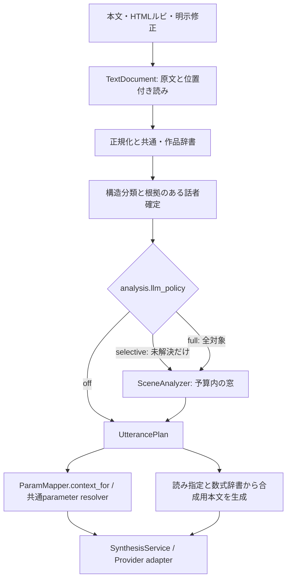

# NLP処理パイプライン

Reader・Batch・SDKの読み上げは、原文と読み指定を保持する共通の発話解析を使う。
Studioは台本の話者・感情指定を維持し、同じ辞書適用・合成サービスへ渡す。

## 原文・読み・正規化

`TextProcessor.process_document()`は`TextDocument`を返す。`original`はルビの親文字を
残した表示本文、`text`は正規化本文、`source_map`は正規化後の各文字が由来する原文の
半開区間`[start, end)`である。NFKCによる展開・結合や注記削除の時点で範囲を伝播する。
変換済み本文の部分一致で位置を推定し直さない。

`extract_html_document()`はinlineタグ間へ改行を挿入せず、`rb`の有無に対応してルビを
`ReadingSpan`へ取り込む。読み指定は範囲・表記・読み・根拠・適用範囲・辞書ID・版を保持する。
優先順位は出現箇所の明示修正、原文ルビ、作品辞書、共通辞書、LLM提案。同順位の重複語句は
長い語句を優先し、採用しなかった競合も`conflicts`へ保存する。共通辞書は同梱英字辞書より優先する。

`Utterance.text_content`が発話に対応する原文・読みを保持し、`synthesis_text`が位置指定を適用する。
`render_speech_text()`は続いて既存の数式辞書・規則を適用する。字幕・表示用本文は上書きしない。
低水準の互換API `TextProcessor.process()`は従来の文字列クリーニングとして残る。

辞書のYAML形式・保存先は[設定リファレンス](configuration.md#analysis)を参照。
未登録の日本語全語をLLMへ送ることはない。`TextDocument.reading_targets`で明示した範囲と、
`suggest_readings: true`の場合の英字語句だけを候補にする。提案は仮名・ID・範囲を検証し、
上位の読みを上書きしない。`reading_proposals`の保存ファイルは未確認扱いで、辞書としては使えない。

## 構造と話者

`TextClassifier.classify()`が全文から位置を持つ論理セグメントを作る。複数文・複数行の
`「台詞」`は一つの発話であり、TTS用に後から分割しても同じ話者と音声意図を継承する。
地の文の段落も位置を保つ。`***`などの場面区切りは合成対象から除き、Planへ警告を記録する。

| content_kind | 分類 |
|---|---|
| `plain` | 括弧・引用を含む一般文章を地の文として読む |
| `novel` | `「」`は台詞、`（）`・`()`・`『』`は心内語 |
| `script` | 台本向け。丸括弧を心内語にしない。Studioでは話者欄をそのまま維持 |

`SpeakerExtractor`の候補一覧と確定話者は別である。発話動詞との対応、既知人物の指定などを
根拠として確定し、直前の主語だけでは確定しない。例えば`空は青かった。「きれいだね。」`の
台詞の話者は未解決となる。機械的な二人交互発話では補完しない。
`Utterance.speaker_origin`は`explicit`・`rule`・`llm`・`default`、`unresolved_reason`は
判断できなかった理由を記録する。

## LLM窓と保留

| llm_policy | 動作 |
|---|---|
| `off` | LLM構築・probe・生成を行わない。辞書・指定・規則だけで合成可能 |
| `selective` | 未解決の台詞・心内語と、明示的に有効にした読み候補を対象にする。地の文は中立 |
| `full` | 場面区切り以外を分析。規則や明示指定で確定した話者は保護する |

既知話者の台詞にLLMで演出を付けたい場合は`full`を使う。新規の推奨例は一般文章向けに
`plain/off`を明示する。未指定の旧設定と配布設定は`novel/full`を維持している。
聴感比較を終える前に既存利用者の解析範囲を切り替えないためである。

`SceneAnalyzer`はsystem・指示・既知人物・周辺文脈・対象本文を同じ入力予算に含める。
出力要求は`512 + 96 × 対象数`で、routeの実効上限と照合する。2,048 tokensなら最大16対象、
4,096 tokensなら既定の`max_items: 25`までになる。日本語・ASCII混在のtoken数は保守的な推定であり、
モデルの厳密なtokenizer計測ではない。

一発話が長すぎる場合は内部範囲へ分割し、発話IDを保って統合する。部分範囲の話者・シーン・感情が
競合したら保留する。応答の`status: deferred`は正当な保留で、欠落とは区別する。
重複ID、対象外ID、未知ラベル、不正な強度は採用せず、不正・欠落対象だけ一度再問い合わせする。
context超過の二分割には深さ・要求数上限があり、予算切れでも成功済み結果と確定済みの読みを保つ。
物理要求の再試行・キャッシュ・使用量計測は既存の`LLMService`が担当する。

窓を作っても、現在のReaderはPlan全体の確定後に再生する。先頭窓からの即時再生は未実装。
ニュースの要約・翻訳は読み上げの`llm_policy`とは独立した明示機能である。

## パラメータと再利用

`ParamMapper.context_for()`がReader・SDK・新Batchに共通のprofile・scene・emotion・明示上書きを
渡し、`resolve_voice_parameters()`が解決する。プロファイルで計算済みの感情は再補正しない。
VOICEPEAKの既存YAMLの速度・pitchは読み込み時に相対値へ変換し、Provider固有の出力値は
adapterで一度だけ生成する。プロファイル固有の演出は既存の計算規則を維持している。
新しい平滑化やシーン持続補正は比較結果がないため採用していない。

Planは本文・読み・解析設定・結果・利用するモデル情報を識別に含める。辞書変更や再解析で
内容が変わった場合は新しいPlanになる。Provider変更だけなら保存済みPlanを再利用する。
合成cacheには実際の合成用本文・Provider版・パラメータを含め、読みが変われば再合成する。
旧manifestの文番号・artifactは既存runのまま維持する。

[実装計画と検証結果](improvement/speech-quality-refactoring-plan.md)、
[原文保持のADR](adr/ADR-0002-utterance-plan-and-identities.md)も参照。
